# 📚 StudyBot — Plataforma Inteligente de Estudos com IA Generativa

> **PWA mobile-first de aprendizagem adaptativa** que combina Inteligência Artificial Generativa, gamificação e arquitetura multi-tenant para revolucionar a forma de estudar — seja para certificações técnicas (AWS), conteúdos escolares ou qualquer assunto.

## 🌐 Acesse o Aplicativo

### 👉 **[https://aws-study.vercel.app/](https://aws-study.vercel.app/)**

> 📱 **Dica:** abra no celular e toque em "Adicionar à Tela Inicial" para instalar como aplicativo (PWA) — funciona inclusive offline para o conteúdo já carregado.


---

## 📌 Sumário

1. [O Problema](#-o-problema)
2. [A Solução](#-a-solução)
3. [📸 Demonstração (Screenshots & GIF)](#-demonstração)
4. [Benefícios da Ferramenta](#-benefícios-da-ferramenta)
4. [Funcionalidades por Perfil](#-funcionalidades-por-perfil)
   - [Aluno](#-perfil-aluno)
   - [Professor / Escola](#-perfil-professor--escola)
   - [Administrador Geral](#-perfil-administrador-geral)
5. [Arquitetura Multi-Tenant](#-arquitetura-multi-tenant)
6. [Inteligência Artificial](#-inteligência-artificial)
7. [Stack Tecnológica](#-stack-tecnológica)
8. [Estrutura do Projeto](#-estrutura-do-projeto)
9. [Modelo de Dados (Firestore)](#-modelo-de-dados-firestore)
10. [Instalação e Configuração](#-instalação-e-configuração)
11. [Variáveis de Ambiente](#-variáveis-de-ambiente)
12. [Scripts Disponíveis](#-scripts-disponíveis)
13. [Segurança e Regras de Acesso](#-segurança-e-regras-de-acesso)
14. [Roadmap](#-roadmap)

---

## 🎯 O Problema

Plataformas tradicionais de ensino a distância apresentam limitações conhecidas:

- **Conteúdo estático e genérico** — PDFs e videoaulas iguais para todos, sem adaptação ao ritmo do aluno;
- **Falta de feedback imediato** — exercícios sem explicação do *porquê* da resposta certa ou errada;
- **Baixa retenção de memória** — sem mecanismos de repetição espaçada, o conteúdo é esquecido em dias;
- **Alto custo de produção para professores** — criar bons simulados, flashcards e materiais didáticos ricos demanda dezenas de horas;
- **Ferramentas fragmentadas** — o aluno estuda em um app, faz flashcards em outro (Anki), simulados em outro, e o professor acompanha desempenho em planilhas.

## 💡 A Solução

O **StudyBot** centraliza todo o ciclo de aprendizagem em um único PWA:

```
Tema desejado → IA gera Teoria + Simulado + Flashcards → Aluno estuda, erra, aprende
→ Professor acompanha acertos/erros em tempo real → Placar e conquistas mantêm o engajamento
```

Com **um clique**, um professor (ou o próprio aluno) gera um pacote pedagógico completo sobre qualquer assunto — de "Amazon S3" a "Equações do 2º Grau" — com teoria em Markdown rico (fórmulas LaTeX, diagramas Mermaid, blocos de código), simulados com explicações detalhadas e flashcards no algoritmo de repetição espaçada SM-2 (o mesmo do Anki).

---

---

## 📸 Demonstração

### 🎬 Fluxo completo do aluno (GIF animado)

<p align="center">
  
</p>

### 🎓 Visão do Aluno (Mobile)

<p align="center">
  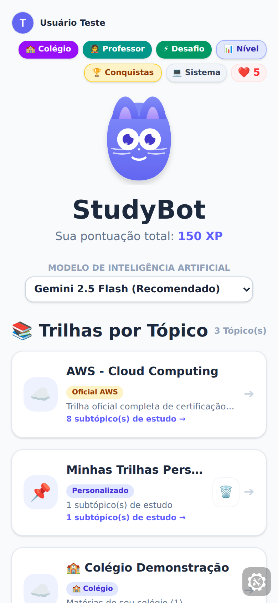
  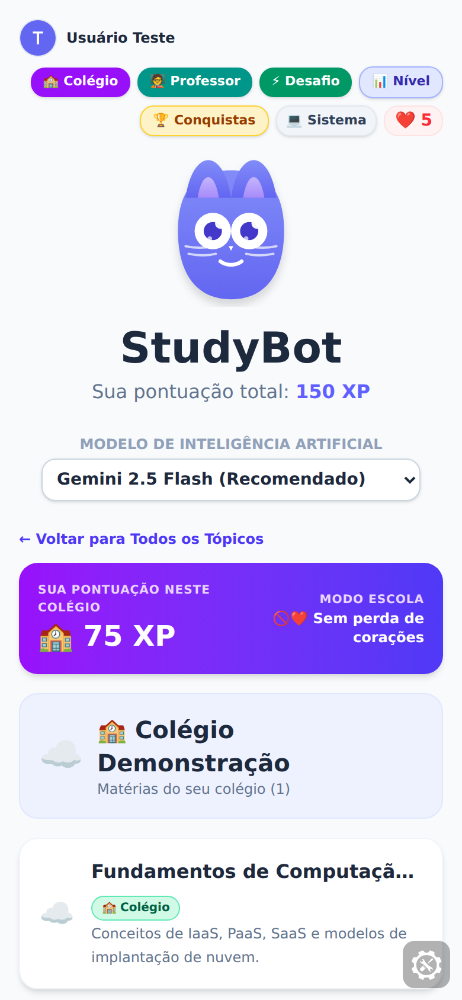
  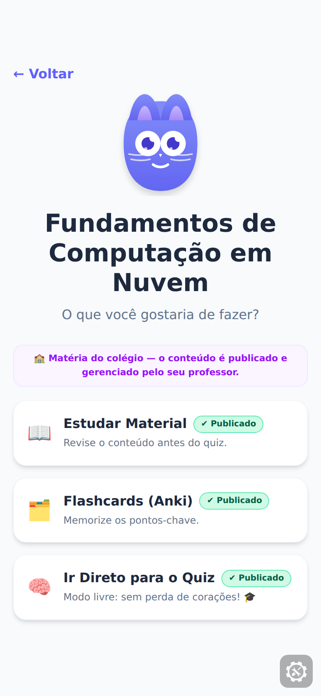
</p>
<p align="center">
  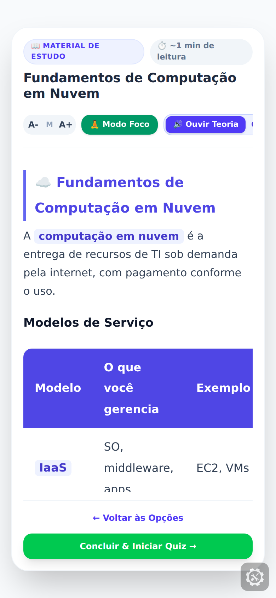
  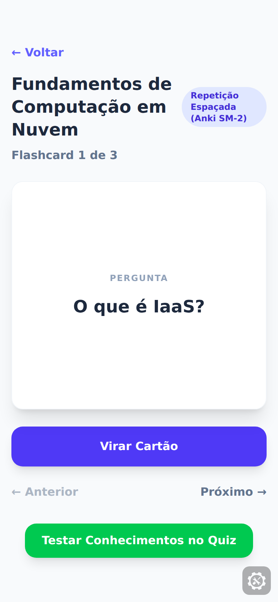
  
</p>
<p align="center">
  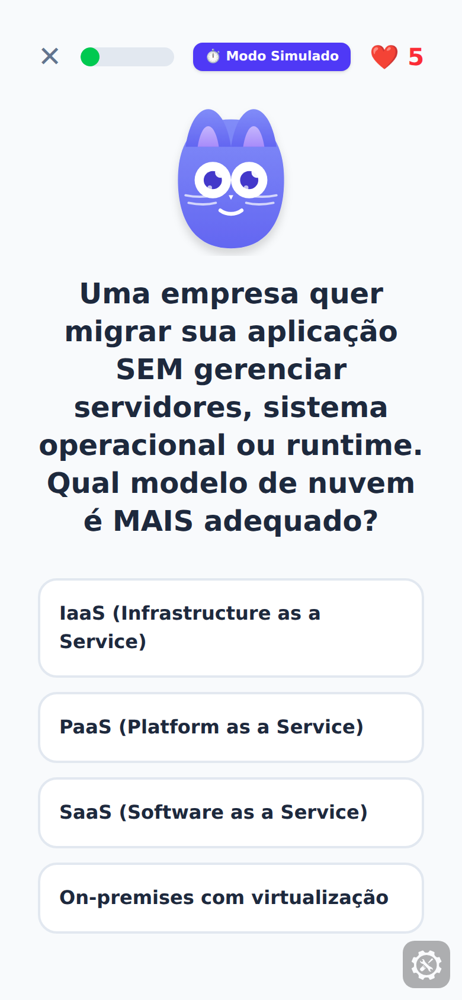
  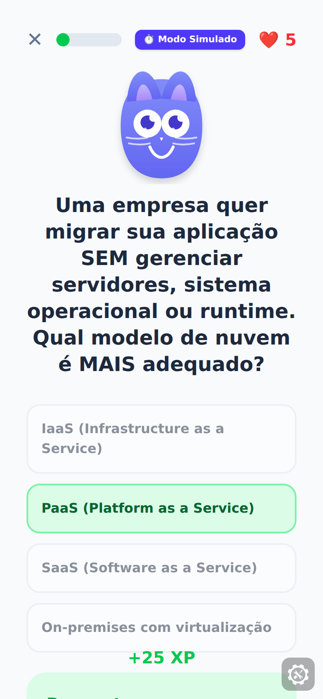
  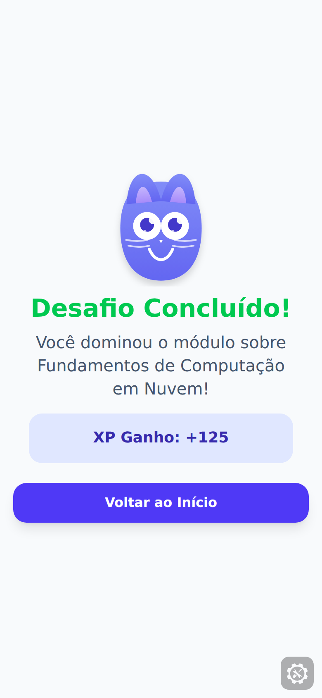
</p>
<p align="center">
  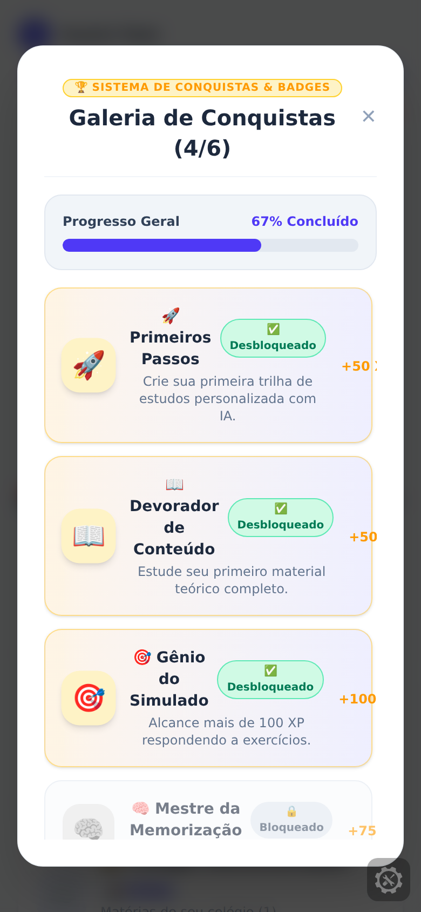
  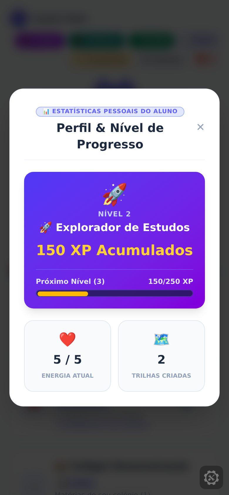
  
</p>

### ⏱️ Simulado Cronometrado (Modo Prova Real)

<p align="center">
  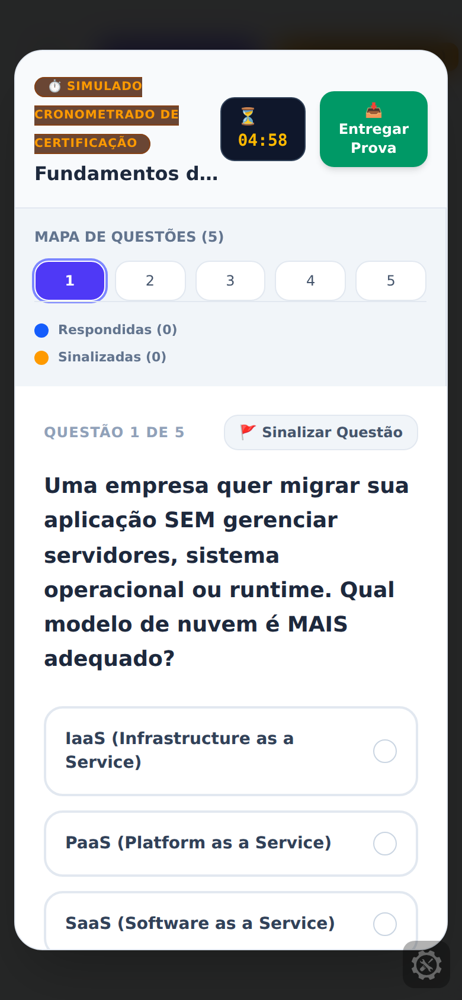
  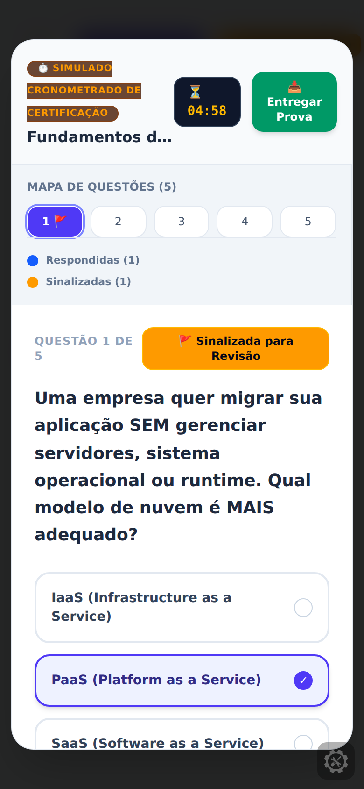
  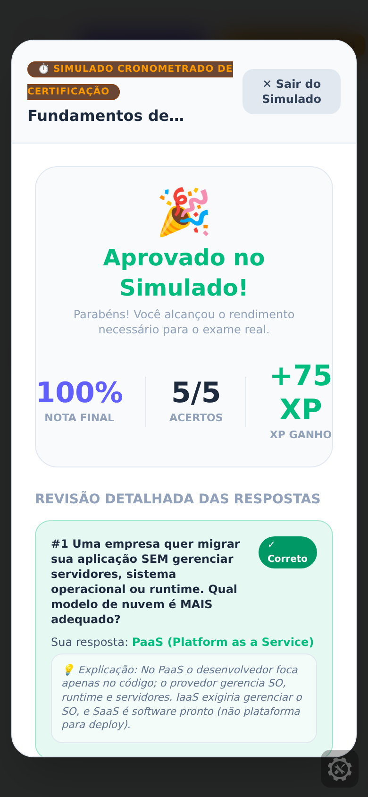
</p>

### 🧑‍🏫 Visão do Professor (Desktop)

<p align="center">
  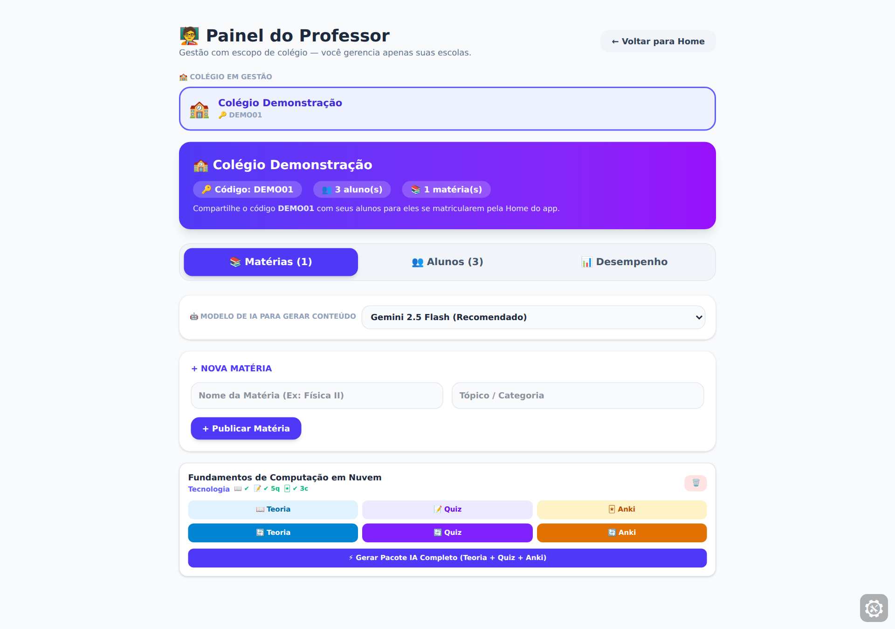
</p>
<p align="center">
  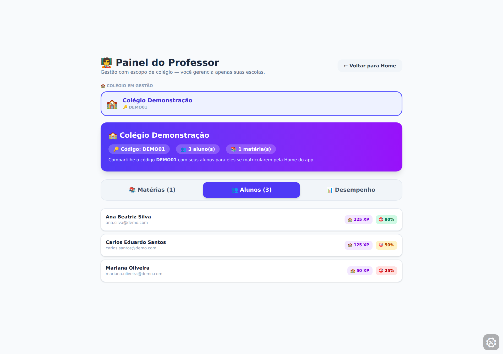
  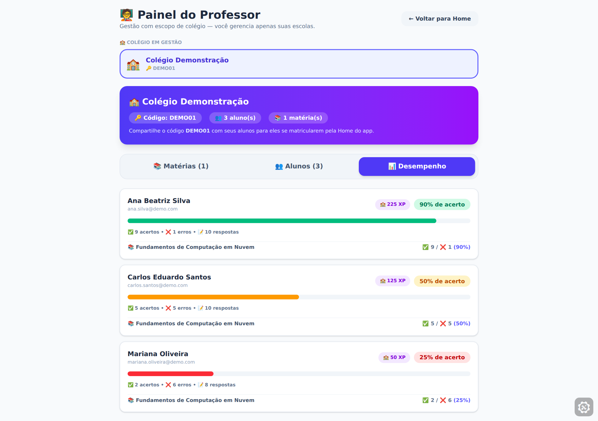
</p>

### 👑 Visão do Administrador

<p align="center">
  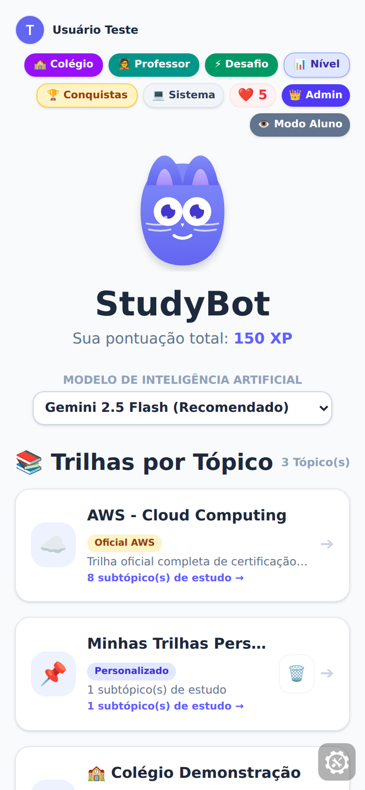
  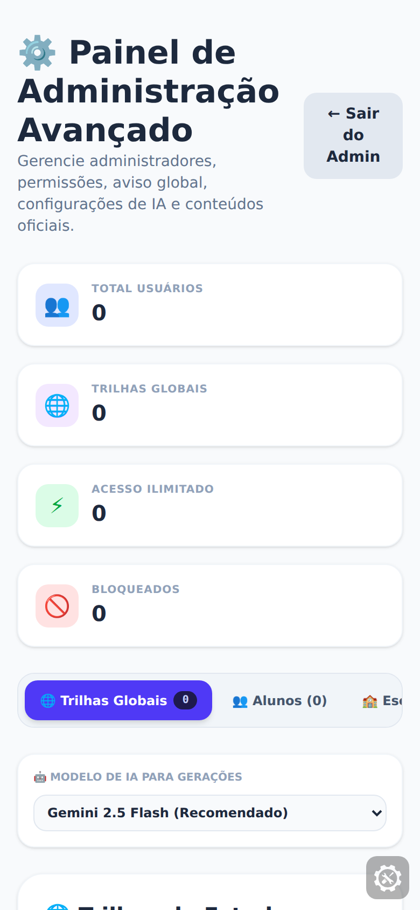
  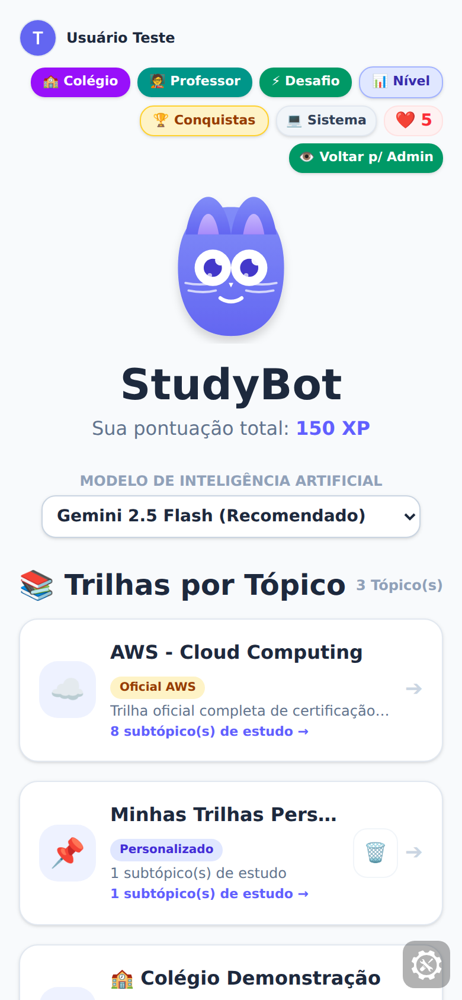
</p>

> 🎭 **Modo Demonstração:** rode o app com `VITE_ENABLE_FIREBASE_AUTH=false` para explorar todas essas telas com um colégio fictício completo — sem precisar de login nem Firebase.

---

## 🌟 Benefícios da Ferramenta

### Para o Aluno
| Benefício | Como a ferramenta entrega |
|---|---|
| **Aprendizado ativo, não passivo** | Quiz com justificativa completa de cada alternativa (por que a certa é certa E por que as erradas são erradas) |
| **Memorização de longo prazo** | Flashcards com algoritmo SM-2 de repetição espaçada — o app agenda a revisão ideal de cada cartão |
| **Acessibilidade** | Leitor de voz (Text-to-Speech) em PT-BR com velocidade ajustável, exportação em PDF, tema claro/escuro, PWA instalável offline |
| **Motivação contínua** | XP, níveis (Aprendiz → Lenda Suprema), conquistas/badges, Desafio Diário Relâmpago e placar por colégio |
| **Simulado real de prova** | Modo cronometrado com mapa de questões, marcação para revisão e relatório diagnóstico (70% = aprovado) |
| **Zero fricção no colégio** | Dentro de matérias da escola não há perda de corações — errar faz parte do aprendizado |

### Para o Professor / Escola
| Benefício | Como a ferramenta entrega |
|---|---|
| **Produção de conteúdo em minutos** | Pacote completo (teoria + quiz + flashcards) gerado por IA com um clique, no modelo de IA de sua preferência |
| **Controle editorial total** | Edição manual de cada teoria, questão e flashcard; regeneração granular (só o que não agradou) |
| **Visão pedagógica real** | Painel com acertos/erros por aluno e por matéria, % de aproveitamento e placar da turma — sem planilhas |
| **Gestão multi-escola** | Um professor pode lecionar em vários colégios e alternar entre eles com um seletor |
| **Matrícula sem fricção** | Aluno entra na turma digitando um código de 6 caracteres |

### Para a Instituição / Administrador
| Benefício | Como a ferramenta entrega |
|---|---|
| **Multi-tenant nativo** | Uma única instalação serve N colégios, professores particulares e alunos independentes, com dados isolados |
| **Governança** | Logs de auditoria de todas as ações administrativas, controle de publicação, bloqueio de usuários |
| **Custo de IA previsível** | Modelos gratuitos disponíveis + cadeia de fallback automática; custo médio de ~US$ 0,0001 por geração |
| **Zero infraestrutura de backend** | Firebase serverless (Auth + Firestore) — sem servidores para manter |

---

## 👥 Funcionalidades por Perfil

### 🎓 Perfil Aluno

**Estudo**
- 📖 Teoria gerada por IA em Markdown rico: tabelas, código com syntax highlight, fórmulas **LaTeX (KaTeX)** e diagramas **Mermaid**
- 🔊 **Ouvir Teoria** — Text-to-Speech em português (0.8x a 1.5x)
- 📓 **Caderno de Anotações** pessoal por tópico (auto-salvamento + exportação `.md`)
- 📄 **Exportar PDF** do material com layout limpo de impressão
- 🃏 Flashcards 3D (flip) com repetição espaçada **SM-2** (Errei / Bom / Fácil)

**Avaliação**
- 🧠 Quiz com feedback pedagógico imediato por questão
- ⏱️ **Simulado Cronometrado** — timer regressivo, mapa de questões, flag 🚩 de revisão, relatório final
- ⚡ **Desafio Diário Relâmpago** — quiz de 90 segundos por XP bônus

**Gamificação**
- ❤️ Sistema de corações (vidas) nas trilhas livres — **desativado dentro de colégios**
- ✨ XP global + **XP específico por colégio**
- 🏆 Galeria de conquistas e 📊 nível de progresso

**Colégios**
- 🏫 Matrícula por código de 6 dígitos
- 👁️ Vê **somente** o que o professor publicou — nunca gera/edita conteúdo escolar
- Placar próprio dentro de cada colégio

### 🧑‍🏫 Perfil Professor / Escola (`/professor`)

Painel com escopo restrito às suas escolas:

- 🏫 **Seletor de colégio** (suporta múltiplas escolas)
- 📚 **Matérias**: criar, excluir, gerar pacote IA completo, regenerar só teoria/quiz/anki
- ✏️ **Edição manual** de teoria, questões e flashcards (com preview de Markdown ao vivo)
- 🤖 **Escolha do modelo de IA** usado nas gerações
- 👥 **Alunos**: lista de matriculados com XP *da escola* e % de acerto
- 📊 **Desempenho**: acertos/erros por aluno e por matéria, barras de aproveitamento (🟢🟡🔴)

### 👑 Perfil Administrador Geral (`/admin`)

Tudo do professor, **mais**:

- 🌐 **Trilhas Globais** — conteúdo oficial para todos os usuários (com importação/exportação **JSON**)
- 🏫 **Gestão de Colégios** — criar escolas, definir professores, gerar matérias
- 👥 **Gestão de Usuários** — filtros, ordenação, seleção múltipla e **ações em massa** (+XP, corações, bloqueio, acesso ilimitado)
- 📣 **Avisos Globais** — banner no topo do app para todos os alunos
- 🤖 **IA & Prompts + Sandbox** — teste prompts em tempo real sem salvar nada
- 📊 **Analytics** — XP médio, cobertura de conteúdo, ranking Top 5
- 📋 **Auditoria** — log de todas as ações administrativas
- 👁️ **Modo Aluno** — visualize o app exatamente como um estudante, para testes

---

## 🏗️ Arquitetura Multi-Tenant

```
┌─────────────────────────────────────────────────────────┐
│                      StudyBot (PWA)                      │
├──────────────┬──────────────────────┬───────────────────┤
│  👑 Admin    │   🧑‍🏫 Professor A      │  🧑‍🏫 Professor B    │
│  (tudo)      │   Escola X + Escola Y │  Escola Z          │
├──────────────┴──────────────────────┴───────────────────┤
│                 Firebase (serverless)                    │
│  globalTrails │ schools/{id}/subjects │ users/{uid}     │
│               │ schools/{id}/scores   │                  │
│               │ schools/{id}/performance                 │
└─────────────────────────────────────────────────────────┘
```

**Princípios:**
- Aluno pode estar matriculado em **vários colégios** (ou nenhum — uso independente)
- Professor vê **apenas** dados das suas escolas (alunos, notas, placar)
- XP de colégio é **isolado por escola** — Escola X nunca vê pontos feitos na Escola Y
- Dentro de colégios: sem corações, sem edição, sem geração por alunos — **o professor é o curador do conteúdo**

---

## 🤖 Inteligência Artificial

Integração via **[OpenRouter](https://openrouter.ai)** — uma única chave de API dá acesso a dezenas de modelos:

| Modelo | Uso sugerido |
|---|---|
| **Gemini 2.5 Flash** ⭐ (padrão) | Melhor custo-benefício para JSON estruturado |
| Gemini 2.5 Flash-Lite | Gerações rápidas e baratas |
| GPT-4o Mini / GPT-4o | Qualidade OpenAI |
| Claude 3.5 Sonnet | Textos didáticos elaborados |
| Llama 3.3 70B / DeepSeek V3 / Qwen 2.5 72B | Alternativas open-weight |
| Nemotron 3 Ultra / Gemma 4 31B | **Gratuitos** |

**Recursos da camada de IA (`geminiService.js`):**
- 🔄 **Fallback automático** — se um modelo falha, tenta o próximo da cadeia
- 🧩 **Normalizador de respostas** — aceita variações de formato dos modelos (array raiz, chaves alternativas, JSON stringificado)
- 🎯 **Prompts contextuais** — detecta se o tema é AWS/certificação ou assunto geral e ajusta o papel da IA
- 📐 **Saída rica garantida** — instruções explícitas para Markdown, Mermaid, LaTeX e JSON válido

---

## 💻 Stack Tecnológica

| Camada | Tecnologias |
|---|---|
| **Frontend** | React 19, Vite 7, Tailwind CSS 4 |
| **PWA** | vite-plugin-pwa, Workbox (offline, instalável, auto-update) |
| **IA** | OpenRouter API (chat completions compatível com OpenAI) |
| **Backend** | Firebase Authentication (Google), Cloud Firestore |
| **Renderização rica** | KaTeX (matemática), Mermaid (diagramas), ReactMarkdown |
| **Voz** | Web Speech API (nativa do navegador) |
| **Qualidade** | ErrorBoundary, ESLint, build de produção validado |

---

## 📁 Estrutura do Projeto

```
aws-study-app/
├── src/
│   ├── App.jsx                    # Orquestrador de rotas/estados
│   ├── main.jsx
│   ├── index.css                  # Estilos globais + Markdown + print
│   ├── firestore.rules            # Regras de segurança do banco
│   ├── components/
│   │   ├── Home.jsx               # Home do aluno (trilhas, colégios, gamificação)
│   │   ├── AdminPanel.jsx         # Painel do Administrador Geral
│   │   ├── TeacherPanel.jsx       # Painel do Professor (multi-tenant)
│   │   ├── StudyMaterial.jsx      # Leitor de teoria (TTS, PDF, notas, edição)
│   │   ├── Quiz.jsx               # Quiz interativo + feedback
│   │   ├── StudyAnki.jsx          # Flashcards SM-2
│   │   ├── TimedExamModal.jsx     # Simulado cronometrado
│   │   ├── TheoryEditorModal.jsx  # Editor manual de teoria (preview ao vivo)
│   │   ├── QuizEditorModal.jsx    # Editor manual de questões
│   │   ├── AnkiEditorModal.jsx    # Editor manual de flashcards
│   │   ├── SchoolEnrollModal.jsx  # Matrícula por código
│   │   ├── AchievementsModal.jsx  # Conquistas
│   │   ├── DailyChallengeModal.jsx# Desafio diário
│   │   ├── StudyStatsModal.jsx    # Nível e estatísticas
│   │   ├── StudyNotebookModal.jsx # Caderno de anotações
│   │   └── ... (Login, LoadingScreen, ErrorBoundary, etc.)
│   ├── hooks/
│   │   ├── useAuthAndData.js      # Auth + trilhas + colégios do usuário
│   │   ├── useStudySession.js     # Sessão de estudo (geração, XP, corações, SM-2)
│   │   └── useThemeManager.js     # Tema claro/escuro/sistema
│   ├── services/
│   │   ├── firebaseService.js     # Firestore (trilhas, escolas, placar, auditoria)
│   │   └── geminiService.js       # Camada de IA (OpenRouter + normalizador)
│   └── utils/
│       ├── achievementsHelper.js
│       └── topicHelpers.js
├── .env                           # Chaves (não commitado!)
├── .env.example
└── vite.config.js                 # PWA + plugins
```

---

## 🗄️ Modelo de Dados (Firestore)

```
globalTrails/{trailId}                 # Trilhas oficiais (admin)
  ├─ title, topic, content, published
  └─ cachedStudy, cachedQuiz[], cachedAnki[]

users/{uid}                            # Perfil do usuário
  ├─ xp, hearts, isAdmin, isUnlimited, isBlocked
  ├─ enrolledSchoolIds: [schoolId...]
  ├─ customTrails/{trailId}            # Trilhas pessoais
  └─ studyLevelProgress/{levelId}      # Cache de progresso

schools/{schoolId}                     # Colégio / Professor particular
  ├─ name, code (6 dígitos), teacherEmails[], teacherUids[], studentUids[]
  ├─ subjects/{subjectId}              # Matérias da escola
  │    └─ title, topic, published, cachedStudy, cachedQuiz[], cachedAnki[]
  ├─ performance/{uid_subjectId}       # Acertos/erros por aluno+matéria
  │    └─ studentName, totalAnswers, correctAnswers, wrongAnswers
  └─ scores/{uid}                      # Placar de XP da escola
       └─ studentName, schoolXp

systemSettings/{doc}                   # announcement, aiConfig
adminAuditLogs/{logId}                 # Auditoria de ações admin
```

---

## 🚀 Instalação e Configuração

### Pré-requisitos
- Node.js 20+
- Projeto Firebase (Auth com Google + Firestore)
- Chave de API do [OpenRouter](https://openrouter.ai/keys)

### Passo a passo

```bash
# 1. Clone o repositório
git clone https://github.com/lucasft-stone/aws-study.git
cd aws-study/aws-study-app

# 2. Instale as dependências
npm install

# 3. Configure as variáveis de ambiente
cp .env.example .env
# Edite o .env com suas chaves (veja a seção abaixo)

# 4. Rode em desenvolvimento
npm run dev          # → http://localhost:5173/

# 5. Build de produção
npm run build
npm run preview
```

### Publicando as regras do Firestore
As regras de segurança estão em `aws-study-app/src/firestore.rules`. No console do Firebase:
**Firestore Database → Regras → cole o conteúdo → Publicar.**

---

## 🔐 Variáveis de Ambiente

| Variável | Descrição |
|---|---|
| `VITE_FIREBASE_API_KEY` | Chave web do Firebase |
| `VITE_FIREBASE_AUTH_DOMAIN` | Domínio de auth (`*.firebaseapp.com`) |
| `VITE_FIREBASE_PROJECT_ID` | ID do projeto Firebase |
| `VITE_FIREBASE_STORAGE_BUCKET` | Bucket do Storage |
| `VITE_FIREBASE_MESSAGING_SENDER_ID` | Sender ID do FCM |
| `VITE_FIREBASE_APP_ID` | App ID do Firebase |
| `VITE_OPENROUTER_API_KEY` | Chave do OpenRouter (`sk-or-...`) |
| `VITE_ROOT_USER_UID` | UIDs/e-mails de admins extras (separados por vírgula) |
| `VITE_HIDE_EXISTING_TRAILS` | `true` oculta trilhas padrão de não-admins |
| `VITE_ENABLE_FIREBASE_AUTH` | `true` ativa backend real; `false` = modo demo local |

> ⚠️ **Nota de segurança:** como é um app client-side, a chave do OpenRouter fica exposta no bundle. Para produção pública em larga escala, recomenda-se mover as chamadas de IA para uma **Cloud Function** (proxy seguro).

---

## 📜 Scripts Disponíveis

| Comando | Ação |
|---|---|
| `npm run dev` | Servidor de desenvolvimento (HMR) |
| `npm run build` | Build de produção otimizado + Service Worker |
| `npm run preview` | Serve o build de produção localmente |
| `npm run lint` | Análise estática com ESLint |

---

## 🛡️ Segurança e Regras de Acesso

| Recurso | Aluno | Professor | Admin |
|---|:---:|:---:|:---:|
| Ver conteúdo publicado de colégio | ✅ | ✅ | ✅ |
| Gerar/regenerar conteúdo de colégio | ❌ | ✅ (só suas escolas) | ✅ |
| Editar conteúdo manualmente | ❌ | ✅ (só suas escolas) | ✅ |
| Ver desempenho dos alunos | ❌ | ✅ (só suas escolas) | ✅ |
| Criar colégios | ❌ | ❌ | ✅ |
| Gerenciar usuários (bloquear, XP em massa) | ❌ | ❌ | ✅ |
| Trilhas pessoais próprias | ✅ | ✅ | ✅ |
| Perder corações em matéria de colégio | 🚫 (não existe) | — | — |

O **Dono do sistema** (`lucasft.pwa@gmail.com`) é imutável e protegido contra bloqueio/exclusão em código e nas regras.

---

## 🗺️ Roadmap

- [ ] Mover chamadas de IA para Cloud Functions (proteger chave em produção)
- [ ] Ranking público da turma (leaderboard semanal por colégio)
- [ ] Professor atribuir "tarefas" com prazo e peso na nota
- [ ] Exportar relatório de desempenho da turma em CSV/PDF
- [ ] Notificações push (FCM) quando o professor publicar novo conteúdo
- [ ] Modo offline completo para matérias já baixadas
- [ ] Suporte a pais/responsáveis acompanhando o progresso

---

## 📄 Licença

Projeto desenvolvido para fins de estudo e pesquisa educacional.

---

<p align="center">
  Feito com ❤️ e 🤖 — <strong>StudyBot</strong>: onde a IA encontra a pedagogia.
</p>
